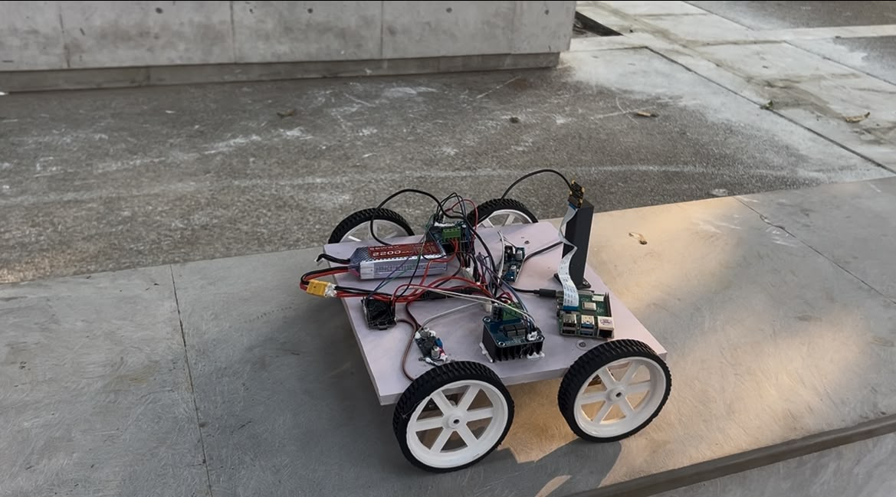
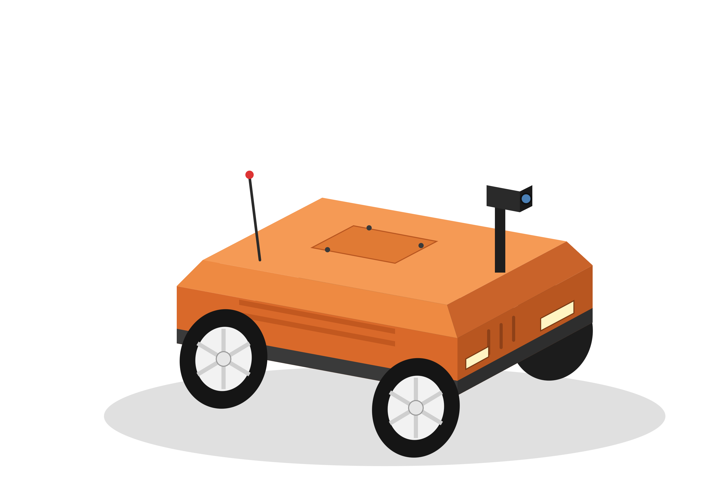

# FireScout: Rescue Intelligence

FireScout is an experimental Raspberry Pi prototype for exploring fire and smoke monitoring during a search-and-rescue mission. It combines camera-based detection, person tracking, room-level mission records, and a live dashboard.

> **Safety:** This is a research/demo prototype, not a certified life-safety system. Sensor values and risk thresholds require calibration; never rely on it as the sole basis for emergency decisions.

## Features

- Detects people, smoke, and flames from a camera stream.
- Tracks people across frames and rooms.
- Estimates smoke severity and calculates room rescue-priority scores.
- Records mission events and snapshots.
- Serves a live dashboard with the annotated video stream.
- Supports Raspberry Pi cameras, USB cameras, and video files.
- Supports optional serial sensor input; simulated readings are available for UI development.

## Demo


[Watch the short demo clip](assets/fire-scout-demo-short.mp4)

## Hardware

- Raspberry Pi 4 or compatible Linux computer
- Raspberry Pi camera or USB camera
- Optional ESP32 or other serial-connected sensor board
- Optional buzzer for local fire alerts

## Rover hardware

The following images show the assembled rover prototype and the covered-top enclosure concept.

### Prototype electronics



*The four-wheel rover during electronics integration and camera and sensor testing.*

### Covered top enclosure concept



*Concept rendering of the rover's protective top enclosure, with raised mounts for the camera and sensors.*

## Setup on Raspberry Pi

The setup script targets 64-bit Raspberry Pi OS and installs the camera dependencies from the system packages:

```bash
chmod +x setup.sh
./setup.sh
source venv/bin/activate
```

On other systems, create a virtual environment and install the Python packages:

```bash
python -m venv .venv
# Linux/macOS
source .venv/bin/activate
# Windows PowerShell
.venv\Scripts\Activate.ps1
python -m pip install -r requirements.txt
```

### Model weights

The model checkpoints are not included in this repository. Place the files named in [firescout/config.yaml](firescout/config.yaml) in the repository root before starting the application:

- `yolov8n.pt`
- `fire_yolov8n.pt`
- `fire_vs_light.pt`

## Run

Start with the automatic camera selection:

```bash
python -m firescout
```

For a USB webcam with simulated sensor readings during UI development:

```bash
python -m firescout --source 0 --simulate-sensors
```

For an ESP32 connected over serial:

```bash
python -m firescout --serial /dev/serial0
```

Open **http://localhost:8080** on the same computer, or replace `localhost` with the Raspberry Pi's network address to view the dashboard from another device.

Configuration lives in [firescout/config.yaml](firescout/config.yaml). Mission logs and snapshots are written to the configured mission data directory.

## Project layout

- `firescout/` — main dashboard, camera, detection, tracking, smoke estimation, sensors, and mission logic
- `pi/` — Raspberry Pi camera streaming utility
- `rescue_detector.py`, `live_detector.py`, `flame_detector.py` — standalone detection workflows
- `train_fire_model.py` — fire-model training script
- `experiments/` — smoke and flame evaluation scripts
- `docs/00_system_design.md` — system design and calibration notes

## Calibration and limitations

Default smoke and risk thresholds are engineering starting points. Calibrate them for the actual camera, environment, and sensors before evaluating results. Simulated sensor values are only for interface development and must not be used as real measurements.
